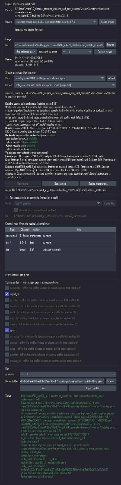
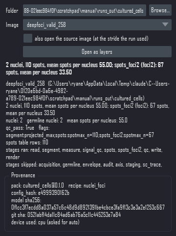
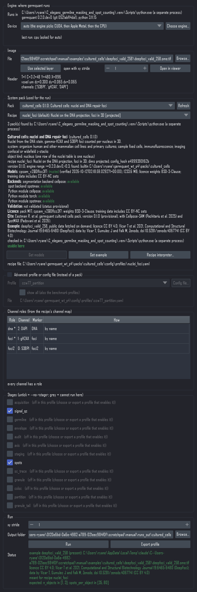

# napari-germquant

A napari front end for **germquant**, the lab's engine for 3D quantification of the C. elegans germline
(nuclei, germline isolation, RAD-51 foci, SYP / PGL-1 colocalization, and the rest of its stages) and, through
the engine's system packs, of other samples such as cultured cells and budding yeast. The plugin does no
measuring of its own. Every run is the engine's own run: usually the command `germquant run` started with the
Python of the engine's environment (the subprocess runner), or, only when you pick it, `germquant.api.run`, the
function that command calls, inside napari (the in-process runner). So a run started from the viewer and one
started in a terminal with the same settings write the same files.
`tests/test_run_widget.py::test_gui_run_writes_the_same_files_as_the_cli` proves that through both runners, on a
synthetic gonad with a config file and on the engine's test pack with `--pack`: same file list, every table
cell-identical (the run_timestamp column aside), same completion marker (every key but `finished`, the time it
was written). The training and time-lapse steps follow the same rule: each button calls the Python function its
command calls (`export-training`, `train-nuclei`, `register-model`, `register`, `track-link`) with the arguments
the command would pass, and the tests check those arguments against the command line.

`napari-germquant` is a working name (see `NAMING.md` for the one-step rename). This is the scaffold of the
plugin described in the engine's `docs/PROPOSAL_general_modular_tool.md` (sections 5, 11 and 12); the engine
README (`README.md` at the top of the `C_elegans_germline_masking_and_spot_counting` checkout) explains what
the stages measure, which profile to use and what the output tables mean. Read that first if you have not.

## What it does today

<p>


</p>

Left: the Run dock after a run of the budding yeast pack on its real example (S-BIAD3750, SUT509 smFISH,
Position 1) through the engine's `.venv`: 11 cells, 8 spots. Right: the Results dock after the cultured cells
pack on its DeepFoci example: 2 nuclei, 110 gamma-H2AX foci and 67 53BP1 foci (the `spots_foci2` instance).
Both were captured headless on the lab workstation on 2026-10-11 (CPU); a headless capture cannot draw napari's
image canvas, so the docks are shown without it.

- **Reader.** File > Open on an `.nd2` (or a TIFF / OME-TIFF, CZI, LIF or OME-Zarr file, through the engine's
  readers extra) adds one Image layer per channel, scaled in microns from the file's voxel size, with the file
  path and channel index kept in the layer's metadata. A time-lapse, multi-position or multi-scene file is
  refused before any pixel is read, with a message that says why (the engine would otherwise silently measure
  time point 0). For a time-lapse the message gives the `germquant run ... --t all` command that runs the
  series and points to the Time-lapse dock, which opens the folder that command writes.
- **Engine** (the top box of the Run dock): which Python environment runs germquant on this computer, and on
  which device. Pack lists, pack checks, Get models, Get example and every run go to that environment, so the
  numbers are made where the models, Cellpose and SpotMAX are installed. With no environment chosen yet, Run asks
  for one (it never quietly runs inside napari instead); Choose engine... changes it at any time. The choice is
  stored for this computer. The box shows the engine's germquant version, git sha and Python, and an amber
  warning when they differ from the germquant napari itself uses. Device: auto (the engine picks CUDA, then Apple
  Metal, then the CPU), cuda, mps or cpu; the line under it says which device the last run used. See "Choosing
  the engine environment" below.
- **System pack** (Run dock). Pick a pack (the C. elegans germline pack, cultured cells, budding yeast, or any
  pack installed for this engine) and one of its recipes. The card shows the title, the system, what one row of
  the nuclei table is (a nucleus or a whole cell), the recipe's dims (3d, projected, ...), the pack version and
  the engine versions it accepts; the models with their state (missing, verified, trusted) and a **Get models**
  button; the backends and Python modules the recipe needs, available or missing with the extra to install;
  the validation status ("not validated" for the provisional 0.1 packs); the licence and citation; and a
  **Get example** button, which fetches the pack's public example image (checked file by file, assembled into
  one OME-TIFF in the examples folder), opens it and makes it the run's image. A recipe that cannot run here is
  greyed with its reason and the fix, and Run is switched off. **Recipe interpreter...** lets one recipe run in
  another Python environment (for example one with an optional backend installed).
- **Run dock**, below the pack: image file (Browse, or the selected layer), a header read (sizes, voxel size,
  channel names), a channel-roles table resolved with the engine's own channel-map rules (red: a required role
  with no channel; amber: a role bound by position because no name matched), one checkbox per stage that has a
  `--no-<stage>` switch (greyed when the recipe has it off or the image lacks a channel role it needs), the xy
  stride, the output folder, **Run** (in a napari thread worker, progress in the status bar) and **Export
  profile**. **Advanced: profile or config file** holds the profile list of the engine checkout's
  `config/profiles/*.yaml` and the config-file picker, as before packs; tick it to run a profile instead of a
  pack. The benchmark profiles (`bench_*`) are hidden there unless "show all" is ticked.
- **Results as layers.** When a run finishes, or from the **Results dock** (Plugins > germquant > Results) on
  any folder germquant wrote: the nucleus labels as a Labels layer with the nuclei table as its features (hover
  a nucleus: its row shows in the status bar), granule and envelope labels when present, the spots as a Points
  layer in microns with the spots table as features (and one Points layer per extra spot instance, such as the
  53BP1 foci of the cultured cells pack), the spots blob image hidden, and on request the source image at the
  stride the run used. A batch root lists the images one folder level down. For a pack run the Labels layer is
  named `<image> cells` or `<image> nuclei` after the pack's object kind, and the Results dock shows a summary
  line (for example "11 cells, 8 spots, mean spots per cell 0.73"), a **Provenance** box (pack id and version,
  recipe, config_hash, model sha256, git sha and the device used) and a red banner when the labels were made by
  another segmenter than the one the pack's recipe declares (the classical watershed where the pack expects
  Cellpose, for example).
- **Export profile.** Writes `<recipe>_<image>.yaml`, an `extends:` overlay marked `validated: false` that
  carries the switched-off stages, and `<recipe>_<image>_commands.txt` with the exact `germquant run` and
  `germquant batch` commands that reproduce the GUI run (plus the same run as the engine runner starts it,
  `<python> -m germquant run ...`, and the overlay form, which gives the same numbers under its own
  `config_hash`). For a pack recipe the commands use `--pack ID@VERSION --recipe R`, and the overlay says
  `extends: pack:<id>@<version>/<recipe>`: ASCII, with no machine path, so the same file resolves on any
  computer that has that pack version.
- **Run logs.** Every run from the dock writes `runs/<run_id>.jsonl` in the folder that holds its output folder
  (never inside the output folder, so the GUI and the command line write the same file list): `run_start` (how
  it ran: through a separate process or in process, the host, the interpreter and whether it was the recipe's
  own, the engine version and git sha, Python, the device asked for and the one selected, the config_hash, the
  image), then `image_done` or `image_failed` (the completion marker's sha256, stage hashes, failed stages, QC,
  the device Cellpose ran on, the time taken), then `run_end`. When that folder cannot be written, the log goes
  to the per-user folder (`%LOCALAPPDATA%\napari-germquant\runs` on Windows).
- **Training dock** (Plugins > germquant > Training). The nucleus training round of the engine's
  `docs/TIMELAPSE.md` ("Segmenting without DAPI: the training loop") in four steps:
  1. **Export slices.** A results folder, a time-lapse series folder or a batch tree goes through
     `germquant export-training` (its Python function, in a thread worker) into a training folder of `image/`
     and `labels/` slice pairs with a `manifest.csv`. Orientations, slices per image, seed, minimum nuclei
     per slice and the size cap are the command's options, with its defaults.
  2. **Correct.** One pair at a time, as an Image layer and an editable Labels layer at the slice's pixel
     size. Previous and Next walk the list `train-nuclei` will read (the manifest rows whose two files
     exist). Leaving a slice with unsaved edits asks whether to save, discard or stay; Revert reloads the
     slice from disk. **Save corrections** writes the Labels layer over `labels/<name>.tif` atomically (a
     temporary file in the same folder, flushed to disk, then renamed over the old one, so a crash never
     leaves half a file) and leaves `manifest.csv` byte for byte as it was. Each save is recorded in
     `corrections.json` in the training folder (name, time, sha256 of the saved file, nucleus count before
     and after); the engine ignores that file, and a record only counts while the file still has that
     sha256. The dock counts the corrected pairs, and before an export into a folder that holds corrected
     slices of the images it would redo it asks first: an export replaces the manifest rows of every image
     it exports and overwrites the slices it draws again.
  3. **Train.** `germquant train-nuclei` in a thread worker: model folder, model name, starting weights
     (`cpsam`, `none` for a random start, a registered model name or a model file), epochs, hold out by
     series or by image, hold-out fraction, split seed, and the device: cuda, mps or cpu. cpu is the
     command's `--cpu`; cuda and mps set `GERMQUANT_DEVICE`, the variable the engine reads, for the duration
     of the call (it is process-wide, so a Run started meanwhile sees it too). A device the computer does not
     have falls back the way the engine always does (the next accelerator, then the CPU) and the summary says
     which device actually trained. The elapsed time and Cellpose's epoch lines (epoch, train loss, test
     loss) go to the status bar; the viewer stays usable, and saving corrections is paused while a model
     trains, because the model card records the sha256 of every pair when training ends. Before it starts,
     the dock says how many pairs were corrected and warns when every pair comes from one series (then
     nothing can be held out). The summary gives the split, the hold-out F1, precision, recall and miss rate
     overall, per orientation and per zone, the design gate from `docs/TIMELAPSE.md`, the model and card
     paths, and the command line that does the same.
  4. **Register model.** `germquant register-model` (model file, card and name are filled in after Train)
     adds the model to `local_models.json` next to the release models; a profile then names it in
     `segmentation.nuclei.cellpose_model`.
- **Time-lapse dock** (Plugins > germquant > Time-lapse). A finished series folder (the `--out` of
  `germquant run SERIES.nd2 --t ...`), read with the engine's own `timelapse.layout`, so the dock sees the
  timepoints the tracking commands see:
  - the per-timepoint nucleus label images as one (T, Z, Y, X) Labels layer, lazy: a dask array with one
    block per plane, so opening reads only file headers and a plane is read from its TIFF page when napari
    shows it. The time slider shows the real t_index; a timepoint the series record lists as done whose files
    are missing is an empty frame. "Labels xy stride" thins a full-resolution series for a quick look;
  - the reference volumes the series loop kept for registration (the segmentation channel at xy stride k,
    8 by default) as an Image layer;
  - `<stem>__track_points.csv` as a Tracks layer (time_track_id, t, z, y, x in microns) with the point
    table as features, and the nuclei without a track (backend `none`, or ones a tracker left out) as a 4D
    Points layer;
  - **Coordinates**: raw (the microscope frame the tables and label images are written in) or registered
    (raw minus each timepoint's cumulative drift from `<stem>__register_shifts.csv`). The tracks take the
    table's own registered columns; the label and reference frames move by that drift rounded to whole
    voxels, the grid `germquant track-export` writes. It is a view: nothing is resampled or written;
  - **Register**: `germquant register` in a thread worker (reference previous or t0, max step, normalization,
    upsample; the command's defaults). The shift table and the summary the command prints (steps, cumulative
    shift, capped steps, nearest-neighbour quality before and after, the brightfield cross-check) show in the
    dock;
  - **Link**: `germquant track-link` in a thread worker with the chosen backend (overlap, overlap_inhouse,
    laptrack or none). The backend parameters come from the series' `run_manifest.json` or the engine's code
    defaults, exactly as on the command line, and the layers are rebuilt from what it wrote. A backend this
    environment cannot run is greyed: laptrack is not installed in the plugin environment (see Install), and
    overlap falls back to the engine's in-house overlap rule when Cell-ACDC is missing (the link record and
    the summary say so).

## What it does not do yet

- A stage can only be switched **off**. The command line has `--no-<stage>` and nothing else, and the plugin
  keeps that parity on purpose. To turn a stage on that a recipe has off, or to change any parameter, choose
  or write a profile (Export profile gives you a starting file; pick it with Advanced, "Config file...").
- Projects (a folder holding the pack version, the images, a sample sheet and any recipe edits, which
  `germquant project run` runs the same way), the role editor, the parameter form, spot tuning and the 2D
  display of single-plane results come in later packages of the engine's tranche 5 (P5 and P6). The run logs
  are written now; nothing reads them back yet.
- A run in a separate process cannot be stopped from the dock; end the `python -m germquant run` process (Task
  Manager on Windows) or close napari.
- The plugin does not run a series. The per-timepoint loop is `germquant run SERIES.nd2 --profile live_syp2
  --t all --out FOLDER` in a terminal (hours for 25 timepoints); the Time-lapse dock opens FOLDER. Track
  import (TrackMate, Imaris, Cell-ACDC), track strips and the biologist validation (`germquant track-import`,
  `track-strips`, `track-validate`) are terminal commands too.
- The Time-lapse labels are a view, not an editor (they are lazy, read-only arrays). Labels are corrected in
  the Training dock, on exported slices.
- Training is practical only on a GPU: 150 epochs of Cellpose-SAM on the CPU take hours. The plugin
  environment on the workstation was installed with the CPU torch wheel (the laptop variant below), so its
  Device list says cuda is not available there. Install the CUDA variant into the plugin environment, or run
  `germquant train-nuclei` in the engine's own `.venv`. The Training dock has been tested with the engine's
  training seams replaced (`_build_net`, `_train_seg`, `_predict`), never with a real training run.
- The reader loads the whole stack into memory (a full-resolution gonad is about 3 GB). Use the stride in the
  Run dock for a quick look; lazy loading is a to-do.
- With the in-process runner the heavy stages need the engine's own extras in this napari environment:
  Cellpose and a torch wheel for nucleus segmentation with the shipped model, SpotMAX and Cell-ACDC for the spots
  stage. Without them a profile's segment stage falls back to the classical watershed (a baseline, not a
  substitute) and the spots stage records a failure in `<image_id>__stages.json`; a pack recipe is refused
  before it runs, because its card names the missing module. This is why the subprocess runner, which runs in
  the engine's own environment, is the usual route. The in-process runner also shares the device setting
  (`GERMQUANT_DEVICE`) with every other engine call in napari while it runs.
- Tested on the lab workstation (Windows 11) on 2026-10-09 with the CPU torch wheel; the Training and
  Time-lapse docks on 2026-10-10 (headless); the pack picker and both runners on 2026-10-11 (headless, CPU).
  Not yet run on a Mac.

## Install

The plugin lives in **its own environment**, never in the engine's `.venv`: Qt and napari must not enter the
pinned environment the validated numbers depend on. You need Python 3.11, the `uv` helper (the engine README's
setup sections say how to get both) and a checkout of the engine (`git clone`, or the unzipped download) with
its `config/` and `packs/` folders: the profiles, channel maps and built-in system packs come from there. The
plugin needs germquant 0.2.0.dev0 or later (the version with system packs); with an older engine the dock says
so in one message and offers profiles and config files only. Below, `<germquant>` is the path of that checkout,
for example `C:\Users\you\C_elegans_germline_masking_and_spot_counting`. Install the engine editable (`-e`), as
below: only an editable checkout finds its built-in packs.

### Windows

Open PowerShell, go into this project's folder (`cd`, a space, drag the folder in, Enter) and run, one at a
time:

```
uv venv --python 3.11 .venv
```

Then torch. On a computer with an NVIDIA graphics card (the workstation), the CUDA wheel the engine README
uses:

```
uv pip install torch torchvision --index-url https://download.pytorch.org/whl/cu128
uv pip install -c <germquant>\constraints\desktop-2026-09.txt --extra-index-url https://download.pytorch.org/whl/cu128 -e "<germquant>[gpu,sc,readers]"
uv pip install -c <germquant>\constraints\desktop-2026-09.txt --extra-index-url https://download.pytorch.org/whl/cu128 spotmax cellacdc
```

On a laptop without NVIDIA (this is the variant that was actually run, on 2026-10-09, with the GPU left to a
running job; the `constraints\desktop-2026-09-cpu.txt` file in this folder is the engine's constraints with
the torch, torchvision and cupy lines removed so the CPU wheel is kept):

```
uv pip install torch==2.11.0 torchvision==0.26.0 --index-url https://download.pytorch.org/whl/cpu
uv pip install -c <germquant>\constraints\desktop-2026-09.txt -e "<germquant>[readers]"
uv pip install -c constraints\desktop-2026-09-cpu.txt cellpose==4.2.1.1 bioio bioio-ome-tiff bioio-tifffile
```

In both cases, finish with the plugin itself (napari 0.9 with PyQt6 and the test tools):

```
uv pip install -c <germquant>\constraints\desktop-2026-09.txt -e ".[dev]"
```

Then the nucleus model, once, into the engine checkout (the plugin's germquant reads it from there):

```
.venv\Scripts\germquant.exe get-model
```

Start napari with `.venv\Scripts\napari.exe`.

Optional, for the laptrack backend of the Time-lapse dock's Link (the engine's `timelapse` extra; its CI pins
0.17.1): `uv pip install laptrack==0.17.1`, then restart napari. Without it the backend is greyed and the
overlap backends still work.

### Mac (Apple silicon)

Not yet run on a real Mac: these are the engine README's Mac lines pointed at this environment. Tell Ryan what
you see. In Terminal, in this project's folder:

```
uv venv --python 3.11 .venv
uv pip install -c <germquant>/constraints/mac-arm64-2026-09.txt -e "<germquant>[gpu,sc,readers]"
uv pip install -c <germquant>/constraints/mac-arm64-2026-09.txt spotmax cellacdc
uv pip install -c <germquant>/constraints/mac-arm64-2026-09.txt -e ".[dev]"
.venv/bin/germquant get-model
```

Do not use the `download.pytorch.org/whl/cu128` lines: that is the NVIDIA build. The plain install brings the
Mac torch, which drives the graphics chip through Metal (`docs/MAC_METAL.md` in the engine). Start napari with
`.venv/bin/napari`.

### Checking the install

```
.venv\Scripts\python.exe -c "import germquant, napari; print(germquant.__file__, germquant.__version__, napari.__version__)"
```

should print a path inside your engine checkout, `0.2.0.dev0` (or later) and `0.9.x`.
`constraints/plugin-venv-2026-10-09.txt` records every package version the workstation install resolved to
(napari 0.9.2, PyQt6 6.11.0 with Qt 6.11.2, npe2 0.9.0, magicgui 0.10.2, numpy 2.4.6, pandas 3.0.3, torch
2.11.0+cpu, cellpose 4.2.1.1, bioio 3.5.1).

## Choosing the engine environment

The Run dock runs germquant in the environment you choose for this computer, not necessarily the one napari runs
in. On the lab workstation they differ: the plugin environment has the CPU torch wheel and no SpotMAX, while the
engine's `.venv` has CUDA torch and SpotMAX. A run inside napari there would segment on the CPU and fail its
spots stage, so the dock asks:

1. The first time you press Run (or Choose engine... in the Engine box), a dialog lists the Python interpreters
   it found: the `.venv` of the engine checkout napari's germquant comes from, when there is one, and napari's own
   Python as a separate process. These are suggestions only. On the workstation pick (with Browse... if it is not
   listed) `C:\Users\ryane\C_elegans_germline_masking_and_spot_counting\.venv\Scripts\python.exe`; on a Mac or
   Linux `<germquant>/.venv/bin/python`. "Run in this napari environment instead (in process)" is there for an
   environment that holds everything (Cellpose, SpotMAX, the models), and is never chosen for you.
2. The dock checks the choice with `<python> -m germquant.packs --version` (germquant version, git sha, Python)
   and refuses an engine without system packs (older than 0.2.0.dev0) with the fix. When the engine's version or
   git sha differs from the germquant napari imports, the Engine box shows an amber warning: the channel roles
   and stage list the dock shows come from napari's copy, the numbers from the engine's. Point both environments
   at the same engine checkout to clear it.
3. From then on, pack lists and checks go through the engine's torch-free entry
   (`<python> -m germquant.packs list --json`, `check ... --json`), so a pack card is refreshed in well under a
   second and never loads torch; Get models and Get example run `fetch-models` and `fetch-example` there; and a
   run is `<python> -m germquant run IMAGE --pack ID@VERSION --recipe R --out FOLDER` (or `--profile`,
   `--config`), the command the Export button writes. Every command is a list of arguments; no shell is used.
4. Both environments can share one model store: set `GERMQUANT_MODELS` to the same folder for both (the engine
   docs recommend it), so Get models fetches a model once.
5. A pack recipe can have its own interpreter (Recipe interpreter... on the card), for a recipe whose optional
   backend lives in another environment. Its card is checked there, its runs go there, and every run log records
   which interpreter ran.

The choice is kept in QSettings for this user on this computer (the registry key
`HKEY_CURRENT_USER\Software\napari-germquant\napari-germquant` on Windows, a plist on a Mac, an ini file on
Linux). Set `NAPARI_GERMQUANT_SETTINGS` to the path of an ini file to keep it there instead (the tests do).

## The first screen

1. Start napari. Open the two docks from the Plugins menu: germquant > Run, and germquant > Results.
2. **Engine**: the first time, press Choose engine... and pick the engine environment's Python (see "Choosing
   the engine environment"). The box then shows where runs go, the engine's version and git sha, and the
   device. (If you skip this, the first Run asks.)
3. **System pack**: pick a pack and a recipe, for example celegans_germline and rad51_foci for a DAPI / SYP /
   RAD-51 panel, or budding_yeast and cells_spots. Read the card: a model shown as missing needs **Get models**
   (on the workstation this adopts the weights already in the Cellpose cache, without a download); a module
   shown as missing needs the extra the card names, installed into the engine's environment. A greyed recipe
   says what stops it and how to fix it; Run stays off until it is fixed. To try a pack on its own example,
   press **Get example**: the image is fetched (or found, if fetched before), opened and made the run's image.
   To run a profile or config file instead, tick **Advanced: profile or config file** and pick it there.
4. Open an image: File > Open File(s)..., pick a per-gonad `.nd2` (or use the image Get example opened). If
   napari asks which reader to use, choose germquant (it can remember the choice in Preferences > Plugins). One
   layer per channel appears, named `<image> [<channel>]`; the channel names come from the microscope file. For
   a quick look at a 3 GB gonad on a laptop, use the Run dock instead: Browse..., set "open with xy stride" to
   4, "Open in viewer".
5. In the Run dock the **Header** line shows the sizes, the voxel size in microns and the channel names.
   A time-lapse or multi-scene file says REFUSED here and cannot be run. With a pack recipe the card is checked
   again with the image, and warns when its pixel size or z step lies outside what the pack expects.
6. **Channel roles**: one row per role of the recipe's channel map, with the channel it resolved to. A `*`
   marks a required role. Red means a required role has no channel: the run cannot start; pick a recipe whose
   map fits the panel, or fix the channel names. Amber means the name did not match and the map's position
   fallback was used; the run will carry a `channel:<role>:name_unmatched_used_index_N` flag.
7. **Stages**: one checkbox per switchable stage, generated from the engine's registry. Ticked = runs.
   Untick one to skip it (the same as `--no-<stage>` in a terminal). Grey with "(off in this profile)" means
   the recipe has it off; grey with "(needs channel role(s) ...)" means the image lacks a channel it needs and
   the engine will skip it on its own.
8. **xy stride** 1 is the validated setting; 2 or 4 is a quick test. **Output folder** defaults to
   `<image stem>_results` next to the image (for the synthetic example inside a pack, the examples folder: a
   pack holds only its own checked files, so the dock refuses an output folder inside one).
9. **Run**. The status bar shows the elapsed time and the engine's log lines; the Status field under the
   buttons shows the result: the objects, QC flags, which stages ran, failed or skipped, where it ran and the
   run log. The labels and the spots appear as layers. Hover a nucleus or cell to see its measurements; the full
   tables are the CSV files in the output folder.
10. **Export profile** asks for a folder and writes the overlay YAML and the commands file. Paste the `run`
    line into a terminal of the engine environment to repeat the run headless, or the `batch` line to process
    every `.nd2` under a folder on the workstation or the cluster, exactly as the GUI would.
11. **Results dock**: Browse to any results folder (or a batch root), pick the image, "Open as layers".
    Tick "also open the source image" to see the labels on the original stack. For a pack run, read the summary
    line, the Provenance box and, if it shows, the red banner.



The System pack card of the cultured cells pack before its run, checked in the engine's `.venv` (models
trusted, every backend available, not validated, licence, citation and the example).

## First run of the Training dock: a corrected nucleus model

For a new marker (the GFP::SYP-2 live series, say) whose nuclei the shipped model misses or merges. You need a
results folder made with the profile you want to improve: a series folder from
`germquant run SERIES.nd2 --profile live_syp2 --t all --out FOLDER`, a fixed-image results folder, or a batch
root.

1. Plugins > germquant > Training.
2. **Results folder**: Browse to that folder. The training folder defaults to `<folder>_training` next to it
   and the model folder to `<folder>_training_model`; change either if you like.
3. Leave xy, xz and yz ticked, 3 slices per image, seed 0. Include the last timepoint of a series: bleaching
   makes it the hardest frame. **Export slices**. The status bar counts the time; when it is done the first
   pair opens as two layers, `<id>_<orient>_<index> image` and `<id>_<orient>_<index> labels`.
4. Correct the labels layer: select it, then use napari's paint brush with a new label id to split a merged
   nucleus or draw a missed one, the fill bucket to merge, the eraser to remove junk. Hide and show the labels
   layer (the eye icon) to compare with the image.
5. **Save corrections**, then **Next**. Repeat. The line under the buttons counts the corrected pairs: about
   30 across zones and timepoints is the design's first training set. A slice not worth correcting can be
   deleted in the file browser (both files, in `image/` and `labels/`); press **Open training folder** to
   reload the list.
6. **Train**. On the workstation choose cuda, 150 epochs, hold out by series (by image when every pair comes
   from one series; the dock warns you). The status bar shows the epoch and the losses (a full GPU training
   has not been timed through this dock yet). The summary under the buttons gives the hold-out F1 and miss
   rate; compare them with the design gate printed below them before using the model for numbers.
7. **Register model** (the fields are already filled in). The status line shows the profile line to use,
   `segmentation.nuclei.cellpose_model: <absolute path of the model file>`, in a profile that `extends:` the
   one you started from. Use the absolute path: the bare model name resolves only in a germquant whose model
   registry holds it, and this plugin's environment and the engine's `.venv` keep separate registries unless
   both set the same `GERMQUANT_MODELS` (the engine refuses an unknown bare name rather than segmenting with
   Cellpose's stock weights). Rerun the series with that profile; export again into a new training folder if
   a second round is wanted.

## First run of the Time-lapse dock: a series as layers

1. Run the series in a terminal of the engine environment:
   `germquant run SERIES.nd2 --profile live_syp2 --t all --out FOLDER`.
2. Plugins > germquant > Time-lapse. **Folder**: Browse to FOLDER (the one with `<stem>__series.json` and
   `t000/`, `t001/`, ...), then **Open**. The info lines list the timepoints on disk, the voxel size, the
   reference volumes, and whether the series is registered and linked. The labels and the reference volumes
   appear as layers with a time slider; drag it to step through the timepoints.
3. **Register** (the defaults are the command's). The shift table fills in: the cumulative drift per
   timepoint, the step length, capped steps, and the nearest-neighbour distance before and after each step.
4. Choose a **Backend** and press **Link**. The tracks appear as a Tracks layer; the layer's features hold
   each point's nucleus id and measurements.
5. Flip **Coordinates** to registered: the drift is taken out of every layer, so what still moves is the
   nuclei themselves. Flip back to raw to check a track against the labels it was linked from.
6. For a full-resolution series, set **Labels xy stride** to 2 or 4 before scrolling through z.

## Headless, and why the numbers agree

With the subprocess runner the dock runs `<python> -m germquant run IMAGE --pack ID@VERSION --recipe R --out
FOLDER` (or `--profile NAME`, or `--config FILE`), plus one `--no-<stage>` per unticked stage and `--xy-stride`
when it is above 1: the command line itself, with the arguments the commands file exports. With the in-process
runner it calls `germquant.api.run(image, pack=..., recipe=... | profile=... | config=..., out=..., xy_stride=...,
overrides={...})`, where the overrides are exactly the `<stage>.config_key: False` entries that `--no-<stage>` sets
on the command line, after the same pack check the command line makes. Every route loads the same recipe file
and applies the same switches, so the `config_hash`, the per-stage hashes and every output file agree (only the
`run_timestamp` fields and the time in the completion marker differ). A pack run records the pack and the
runtime (device asked for and used, torch, Python) in `run_manifest.json` and `<image_id>__stages.json`; these
never enter a table, a hash or the completion marker. The exported overlay YAML is a different object: a profile
hashes as text, so a run made with it has its own `config_hash` and the same numbers; the commands file says so.
Identical numbers are claimed within one environment and one device; the run log says which ran.

## Tests

Headless, with napari's `make_napari_viewer` fixture (pytest-qt). From this folder:

PowerShell:
```
$env:QT_QPA_PLATFORM="offscreen"; $env:CUDA_VISIBLE_DEVICES="-1"; .venv\Scripts\python.exe -m pytest tests -q
```
Mac / Linux:
```
QT_QPA_PLATFORM=offscreen CUDA_VISIBLE_DEVICES=-1 .venv/bin/python -m pytest tests -q
```

What runs: the npe2 manifest (valid, named like the distribution, reader patterns equal the engine's suffix
list), the engine glue (profiles, recipes, role rows, stage rows, the plan and its commands, the exported
overlay loading through the engine), the reader (one layer per channel, the stride, the pixels equal what the
pipeline reads, the time-lapse and multi-scene refusals from the header), the Run dock (roles table and stage
checkboxes on the synthetic gonad and on a one-channel file, the plan, the export, and the GUI-versus-CLI
identity run: the config route with the classical segmenter and spots off, and the test pack's basic recipe
with `--pack`, each through the in-process runner and through the subprocess runner with this Python as the
engine interpreter, comparing the file list, every CSV and parquet table cell and every completion-marker key
but `finished`, and the run log beside the output folder), the system packs (`tests/test_pack_picker.py`: the
built-in packs and the test pack under `$GERMQUANT_PACKS` listed through both runners with the card; a recipe
whose model is missing greyed with the fix and Run off; Get models downloading a 64-byte stand-in model from a
server the test runs on 127.0.0.1 until the recipe is usable; Get example fetching two per-channel TIFFs from
that server, assembling them and opening the image; a pack whose rows are cells naming the Labels layer
`<image> cells`, saying cells in the summary, and showing the banner when the pack declares Cellpose but the
labels came from the classical segmenter; the export with `--pack` and a portable, ASCII overlay that the engine
loads; a broken pack greyed with its problem; an output folder inside a pack refused; the test pack copy
matching its SHA256SUMS and the engine's), the engine runners (`tests/test_engine_runner.py`: the version check
and the warning for another version or git sha, from a stand-in engine package; the one message for an engine
without packs, in this environment and through a subprocess; the dock asking for an engine instead of running
in process; a recipe mapped to a second interpreter, a throwaway venv, running there with run_start recording
it; a pack card refresh through the subprocess runner whose Python import log shows no torch, Cellpose, SpotMAX
or CuPy and whose model check trusts the verified blob without hashing it again; the run log's place and
format), the results loader and dock on a hand-made results folder, the Training dock (`tests/test_training.py`: two finished runs written by the test with an
OME-TIFF source each; the export through the dock in a thread worker, which writes the same manifest and slices
as `germquant export-training`; paging; a correction saved atomically with the manifest byte-identical; the
refusals; the guard against exporting over corrections; training with the engine's Cellpose seams replaced, the
button returning at once while a gated fake training runs and its epoch line reaching the status bar; the device
choice reaching the engine, with `GERMQUANT_DEVICE` restored afterwards; registration into a private registry
under `GERMQUANT_MODELS`), and the Time-lapse dock (`tests/test_timelapse.py`: a three-timepoint series with
drift, flow and shuffled ids written in the engine's layout; the lazy stack reads nothing at build time and one
page per plane; the registered view equals the engine's `track.place_frame` grid; a missing timepoint is an
empty frame; Register and Link in thread workers; the Tracks layer in raw and registered coordinates; the
register_shifts, track_points and tracks tables a Link from the dock writes equal those of `germquant register`
and `germquant track-link` on a copy, timestamps aside). Every dock is also opened through napari's plugin
menu route, which hands it a proxy of the viewer. Two more tests are data dependent: `realdata` reads the
header of a local `.nd2` copy and skips when it is absent; `nas` reads the header of the live GFP::SYP-2
series on the lab NAS (56 GB, header only, T=25 refused) and runs only with `NAPARI_GERMQUANT_NAS_TEST=1`.

Every test has its own settings file (`NAPARI_GERMQUANT_SETTINGS`), so no test reads or changes the engine
stored on this computer, and the pack tests keep every pack folder and store private (`$GERMQUANT_PACKS` set to
`tests/fixtures/packs`, an empty `$GERMQUANT_MODELS`, an empty Cellpose cache, a private examples folder). The
test pack in `tests/fixtures/packs/test_pack` is a byte-for-byte copy of the engine's
`tests/fixtures/packs/test_pack`; copy it again when the engine's changes.

To run the suite against an engine checkout other than the one installed, put both source folders first on the
path, for example on the workstation:

```
$env:PYTHONPATH="C:\path\to\napari-germquant\src;C:\path\to\germquant\src"; $env:QT_QPA_PLATFORM="offscreen"; $env:CUDA_VISIBLE_DEVICES="-1"; .venv\Scripts\python.exe -m pytest tests -q
```

The subprocess runner tests use this Python as the engine interpreter and pass the same path on to it.

### Continuous integration

`.github/workflows/ci.yml` runs ruff and the whole suite on ubuntu-latest, windows-latest and macos-14 (Apple
Silicon) with Python 3.11 and `QT_QPA_PLATFORM=offscreen`. It checks the engine out from its public repository
at a pinned commit (the head of the engine's integration branch while a train is open, then the engine's main
commit once the engine pull request has merged, and only then does the plugin pull request merge), installs it
editable with the readers extra, compares the test pack copy's SHA256SUMS with the engine checkout's and
verifies every file of the copy against it. Pins: the engine checkout's constraints files plus
`constraints/ci-plugin-2026-10.txt` (napari, PyQt6, pytest-qt at the workstation's versions).

On 2026-10-10 both new docks were also driven headless on a scratch copy of the first four timepoints of the
live GFP::SYP-2 series (xy stride 2, 76 x 1360 x 1360 labels per timepoint; two runs): opening took 1.5 to
1.9 s and a label plane 0.02 s, Register reproduced the series' own `register_shifts` numbers, Link with
overlap_inhouse ran in 6 to 9 s, and Export wrote 18 pairs from t000 and t003 in 12 to 14 s.

Qt's `offscreen` platform plugin cannot create an OpenGL context on Windows (or macOS), and napari queries two
OpenGL limits while it builds a viewer. A hidden viewer never draws, so `tests/conftest.py` gives those two
queries constants whenever the platform is `offscreen`; nothing is rendered in the suite and the GPU is never
touched. With `QT_QPA_PLATFORM` unset on a desktop session, napari queries the real driver as usual.

## Layout

- `src/napari_germquant/napari.yaml`: the npe2 manifest (reader, four widgets).
- `_engine.py`: the glue to `germquant.api`, no Qt: profiles, recipes (a profile, a config file or a pack
  recipe), role rows, stage rows, `RunPlan` (the one description a run has, executed by an engine runner and
  spelled out as commands for the terminal), the system-pack feature gate.
- `_runner.py`: where germquant runs, no Qt: `SubprocessRunner` (the engine interpreter, the torch-free
  `python -m germquant.packs` entry for listing, checks and fetching, `python -m germquant run` for runs) and
  `InProcessRunner`, the version check, interpreter suggestions, and the run logs.
- `_packs.py`: an engine's pack listing and the pack card, no Qt.
- `_settings.py`: the per-machine settings (QSettings): the engine interpreter, recipe interpreters, the device.
- `_engine_widgets.py`: the Engine box, the interpreter dialog and the System pack picker.
- `_reader.py`: the reader and the single-time-point check.
- `_results.py`: a results folder as layer tuples, no Qt.
- `_training.py`: the training round without Qt (export, the pair list, the atomic save and
  `corrections.json`, train with the device choice, register, the command lines).
- `_timelapse.py`: a series folder without Qt (the lazy label and reference stacks, raw or registered, the
  Tracks and Points data, the register_shifts summary, Register and Link with the commands' arguments).
- `_run_widget.py`, `_results_widget.py`, `_training_widget.py`, `_timelapse_widget.py`: the four docks.
- `_qt_common.py`: adding layer tuples, the log-to-status-bar bridge, and the worker runner the Training and
  Time-lapse docks use (one engine call at a time in a napari thread worker, elapsed time and log lines in the
  status bar).
- `constraints/`: the CPU-filtered constraints copy, the record of the workstation install and the CI pins.
- `tests/fixtures/packs/test_pack`: the engine's test pack, copied (CI checks the copy).
- `.github/workflows/ci.yml`: the CI workflow. `docs/screenshots/`: the pictures in this README.

## License

MIT, like germquant.
